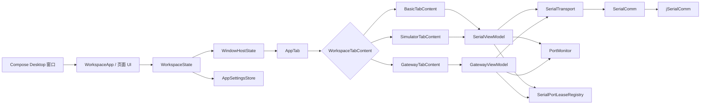

# KSerial 架构说明

本文档描述 KSerial 当前的运行时结构、主要职责边界，以及新增功能时建议遵循的扩展方式。

## 总体架构

## 各层职责

| 层级 | 主要类型 | 职责 |
| --- | --- | --- |
| 应用外壳 | `main.kt`、`WorkspaceApp` | 创建窗口、渲染导航和当前页面 |
| 工作区 | `WorkspaceState`、`WindowHostState`、`AppTab` | 管理标签页、浮动窗口、全局偏好和会话生命周期 |
| 标签内容 | `WorkspaceTabContent` 及其实现 | 让每个标签页明确持有一种功能会话，负责状态传播和释放 |
| 功能状态 | `SerialViewModel`、`GatewayViewModel` | 编排连接、发送、接收、日志以及页面状态 |
| 串口边界 | `SerialTransport` | 隔离上层业务状态与具体串口实现，便于测试和替换实现 |
| 串口实现 | `SerialComm` | 使用 jSerialComm 完成串口打开、读写和事件监听 |
| 共享基础设施 | `PortMonitor`、`SerialPortLeaseRegistry`、`AppSettingsStore` | 端口发现、端口独占和设置持久化 |

## 关键设计约束

1. 标签页拥有业务会话，窗口只负责承载标签页。标签页在主窗口与浮动窗口之间移动时，不应重建串口连接或丢失页面状态。
2. 一个 `AppTab` 只持有一个 `WorkspaceTabContent`，不通过多个互斥的可空 ViewModel 表达页面类型。
3. 所有实际串口访问都经过端口租约管理，避免两个功能同时占用同一个端口。
4. 页面和 ViewModel 不直接依赖 jSerialComm API，而是通过 `SerialTransport` 与串口实现交互。
5. 协议类功能保持独立，不把协议请求、响应和重试逻辑继续堆入 `SerialViewModel`。

## 新功能扩展方式

新增一个独立功能时，通常需要：

1. 增加对应的 `WorkspaceSection` 和 `WorkspaceTabContent` 实现。
2. 创建独立的页面和 ViewModel，由内容对象管理其生命周期。
3. 在 `WorkspaceState` 中增加内容工厂，并在 `WorkspaceApp` 中增加穷尽式渲染分支。
4. 如果需要串口，接入 `SerialPortLeaseRegistry`，并根据功能特点选择复用 `SerialTransport` 或使用独立的第三方库适配层。
5. 为内容创建、释放、端口冲突和核心请求流程增加测试。

以未来可能增加的 Modbus 功能为例，应优先使用 j2mod，并建立独立的 `ModbusViewModel` 与 j2mod 适配层。标准功能码、帧结构、CRC 和异常响应由成熟库处理，不在项目中重新手动实现。是否复用当前原始字节传输接口，应以 j2mod 的串口接入方式为准，不强行耦合。

## 当前可继续优化的部分

- `App.kt` 仍集中承载较多页面代码。出现新的大型功能时，可按 `feature/terminal`、`feature/simulator`、`feature/gateway` 等目录逐步拆分。
- `SerialViewModel` 同时协调连接、日志、发送和部分偏好状态。只有当这些职责继续增长时，再提取连接会话、日志状态等独立组件，避免为了形式提前拆分。
- 当前单 Gradle 模块足以支撑项目规模；当出现可独立复用、独立发布或构建边界明显的协议组件时，再考虑多模块化。
