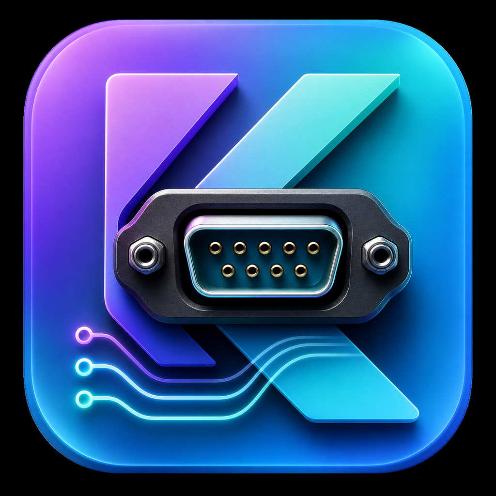

<p align="center">
  
</p>

<h1 align="center">KSerial</h1>

<p align="center">A cross-platform desktop serial workbench combining a serial console, device simulator, and serial bridge.</p>

<p align="center">
  <a href="README.md">简体中文</a> · <strong>English</strong> · <a href="README.ja.md">日本語</a>
</p>

<p align="center">
  <a href="https://github.com/yiaobang/KSerial/actions/workflows/release.yml"></a>
  <a href="https://github.com/yiaobang/KSerial/releases/latest"></a>
  <a href="LICENSE"></a>
  
</p>

KSerial is built with Kotlin and Compose Multiplatform for embedded development, hardware bring-up, protocol verification, and serial device testing. Alongside everyday serial communication, it brings automatic replies, device behavior simulation, and multi-port routing into one tabbed workspace.

## Highlights

- Discover serial ports automatically and configure baud rate, data bits, stop bits, parity, and flow control.
- Send and receive text or HEX data with live HEX validation, formatting, loop sending, and quick commands.
- Reuse bounded send history with keyboard navigation, and calculate CRC16-Modbus, XOR, SUM8, or LRC checksums.
- Inspect TX/RX counters, search and filter logs, highlight keywords, copy entries, export TXT/CSV, and persist traffic to disk.
- Describe device response rules in JSON or HOCON `.conf` files, with fixed-length and delimiter-based framing.
- Connect multiple serial endpoints with configurable one-to-one, one-to-many, and many-to-many routes.
- Work with multiple tabs, detach tabs into separate windows, merge them back, and prevent duplicate port ownership.
- Switch between Simplified Chinese, English, and Japanese, with light and dark themes.
- Download installers and portable distributions for Windows, macOS, and Linux, built by GitHub Actions.

## Workspaces

| Workspace | Purpose |
| --- | --- |
| **Serial Console** | Everyday serial debugging: connect devices, exchange text or HEX data, loop or quick-send commands, filter logs, and save TX/RX traffic. |
| **Device Simulator** | Match incoming frames and reply from configuration, useful for simulating devices, testing host software, and repeating protocol scenarios. |
| **Serial Bridge** | Manage multiple serial endpoints and forwarding routes for pass-through, relaying, and multi-device integration tests. |

Each workspace supports multiple independent tabs. A tab can be detached into its own window and merged back into the main window later.

## Download

Download the latest build for your operating system from [GitHub Releases](https://github.com/yiaobang/KSerial/releases/latest):

| Platform | Installers | Portable distribution |
| --- | --- | --- |
| Windows | `.msi`, `.exe` | `.zip` |
| macOS | `.dmg`, `.pkg` | `.zip` |
| Linux | `.deb`, `.rpm` | `.tar.gz` |

Release packages include the application runtime, so end users normally do not need to install a JDK. Windows code signing and macOS signing/notarization are not configured yet, so the operating system may show a security warning on first launch.

## Quick start

1. Open **Serial Console** and select `+` to create a tab.
2. Choose a port and set its baud rate and other parameters under “Connection & Settings.”
3. Open the port and send text or HEX data from the input area at the bottom. Before sending, text mode fully decodes `\\`, `\'`, `\"`, `\?`, `\a`, `\b`, `\e`, `\f`, `\n`, `\r`, `\s`, `\t`, `\v`, octal `\ooo`, raw-byte `\xHH`, Unicode `\uHHHH` / `\UHHHHHHHH`, and control-character `\cX` escapes.
4. Enable loop sending, quick commands, keyword highlighting, log filters, or TX/RX persistence as needed.

To emulate a device, load a rule file in **Device Simulator**. To forward data across ports, load endpoint and route configuration in **Serial Bridge**.

### Runtime directory and `settings.conf`

On first launch, KSerial uses `System.getProperty("user.dir")` as its runtime root, creates a `conf` directory, and writes:

- `settings.conf` for global settings;
- `01-simulator-minimal.conf` through `06-bridge-multi-route.conf` as progressive Device Simulator and Serial Bridge examples.

Device Simulator and Serial Bridge file dialogs open this `conf` directory first. When upgrading, KSerial copies the legacy user settings file if the new directory does not yet contain `settings.conf`. Example files are created only when missing and never overwrite user edits.

KSerial writes `settings.conf` as comment-free HOCON. Manually added comments can be read, but they are removed on the next save. If KSerial is installed under a protected location such as `Program Files`, the current user must have write access to the runtime directory before `conf` can be created or updated.

| Field | Description |
| --- | --- |
| `schemaVersion` | Settings schema version; do not edit manually. |
| `appearance.darkTheme` | Whether to use the dark theme. |
| `appearance.alwaysOnTop` | Whether windows stay always on top. |
| `appearance.language` | UI language: `zh`, `en`, or `ja`. |
| `serial.selectedPort` | Last selected port; the selection is restored without opening it automatically. |
| `serial.baudRate` | Baud rate. |
| `serial.dataBits` | Data bits, from 5 through 8. |
| `serial.stopBitsIndex` | Stop-bits index: `0=1`, `1=1.5`, `2=2`. |
| `serial.parityIndex` | Parity index: `0=None`, `1=Odd`, `2=Even`, `3=Mark`, `4=Space`. |
| `serial.flowControlIndex` | Flow-control index: `0=None`, `1=RTS/CTS`, `2=DSR/DTR`, `3=XON/XOFF`. |
| `preferences.showRealTime` | Whether timestamps appear in logs. |
| `preferences.hexDisplay` | Whether received data is displayed as HEX. |
| `preferences.hexSend` | Whether send input is interpreted as HEX. |
| `preferences.saveSend` / `saveReceive` | Whether transmitted and received data are saved. |
| `preferences.quickCommandsText` | Quick-send commands, one per line, using the same escapes as text send. |
| `preferences.highlightEnabled` / `highlightIgnoreCase` / `highlightKeywords` | Keyword highlight switch, case rule, and keyword list. |
| `preferences.logQuery` / `logOnlyMatches` | Last log query and whether only matching entries are shown. |
| `preferences.logAutoScroll` | Whether logs automatically scroll to the bottom. |
| `preferences.logShowTx` / `logShowRx` / `logShowInfo` | Whether each log type is visible. |
| `sendHistory` | Newest-first, deduplicated send history with at most 100 entries. |

The send input, loop-send switch, and loop interval are not persisted, and no serial port is opened automatically at startup.

## Configuration-driven simulation and bridging

The repository contains a progressive set of HOCON examples, from a minimal simulator to multi-endpoint routing. See the [configuration guide](config_samples/README.en.md) for the learning path, field reference, and comment syntax:

- [Minimal Device Simulator](config_samples/01-simulator-minimal.conf)
- [Text Device Simulator](config_samples/02-simulator-text.conf)
- [Fixed-length HEX Device Simulator](config_samples/03-simulator-hex-fixed-length.conf)
- [One-way Serial Bridge](config_samples/04-bridge-one-way.conf)
- [Bidirectional Serial Bridge](config_samples/05-bridge-bidirectional.conf)
- [Multi-endpoint, multi-route Serial Bridge](config_samples/06-bridge-multi-route.conf)

HOCON `.conf` files accept `#` and `//` comments, so port roles, protocol notes, and debugging context can stay next to the configuration.

Device Simulator example:

```hocon
simulator {
  endpoint {
    port = "COM2"
    baudRate = 9600
    dataBits = 8
    stopBits = 1
    parity = "none"
    flowControl = "none"
    autoOpen = false
  }

  encode = "ASCII"
  delimiter = "\r\n"

  rules = [
    { request = "AT\r\n", response = "OK\r\n" }
  ]
}
```

Use `HEX` for `encode` when working with byte-oriented rules. `packSize` enables fixed-length framing, while `delimiter` enables delimiter-based framing; at least one must be present. Configuration loading reports common errors such as invalid HEX, empty delimiters, duplicate ports, and broken route references.

## Run from source

Requirements:

- JDK 25
- The Gradle Wrapper included in this repository

Windows:

```powershell
.\gradlew.bat :composeApp:run
.\gradlew.bat :composeApp:jvmTest
.\gradlew.bat :composeApp:packageDistributionForCurrentOS
```

macOS / Linux:

```bash
./gradlew :composeApp:run
./gradlew :composeApp:jvmTest
./gradlew :composeApp:packageDistributionForCurrentOS
```

## Automated releases

The application version is defined by `appVersion` in `gradle.properties`. Pushing a matching `v*` tag, such as `v1.0.0`, starts the `Build and Release` workflow. It tests and packages the application on Windows, macOS, and Linux, then creates or updates the matching GitHub Release with a `SHA256SUMS.txt` file.

Regular pushes to `master` and pull requests only run JVM tests; they do not package or publish the application. A manually started release workflow validates multi-platform packaging by default and creates or updates a Release only when its `publish` option is explicitly enabled.

## Technology

- Kotlin Multiplatform
- Compose Multiplatform / Material 3
- kotlinx.coroutines / Flow
- jSerialComm
- kotlinx.serialization
- Typesafe Config
- Gradle / jpackage


## License

KSerial is available under the [Apache License 2.0](LICENSE).

If KSerial helps you, please consider giving the project a ⭐ on GitHub. It is a small gesture that helps the project keep improving.
